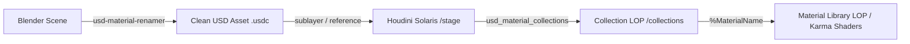

# USD Material Collections for Houdini Solaris

[](https://www.sidefx.com/)
[](https://openusd.org/)
[](https://www.python.org/)
[](https://opensource.org/licenses/MIT)

A production-grade Python tool and shelf utility for **Houdini Solaris (LOPs)** that automatically generates USD Collections with wildcard primitive patterns from USD mesh hierarchies and material bindings.

Designed as the dedicated Houdini counterpart to [**usd-material-renamer**](https://github.com/TEJARAVIVARMA/usd-material-renamer) for automated DCC $\rightarrow$ Solaris lookdev pipelines.

---

## The Problem It Solves

When importing high-complexity assets (such as vehicles, machinery, or architectural scenes with 30–100+ materials) into Houdini Solaris for lookdev, artists typically organize shading by creating **USD Collections** and binding them in a **Material Library LOP**.

However, doing this manually introduces significant production bottlenecks:

1. **Manual Labor**: Creating and wiring 40+ Collection LOPs (or configuring 40+ multiparm entries) and typing wildcard rules (`**/*Aluminium`, `**/*Black_Plastic`, etc.) is tedious and prone to human error.
2. **The Substring Wildcard Collision Trap**:
   - A wildcard pattern like `**/*Glass` matches `Ferrari_Glass`, but also accidentally matches `Ferrari_Red_Glass` and `Ferrari_Motor_Glass`!
   - Similarly, `**/*Metal` matches `Motor_Black_Metal` and `Red_Metal`, causing incorrect shaders to overwrite intended materials.
3. **The Primitive Path Discovery Trap**:
   - In Solaris, shorthand collection references (e.g. typing `%Aluminium` into a Material Library `Geometry Path`) **strictly resolve to collections authored under `/collections`**.
   - Custom paths (like `/selections/collections`) prevent `%<name>` from being detected without typing lengthy USD path expressions (`%{/selections/collections:name}`).

---

## Pipeline Architecture



---

## Features

- **Automated Stage Inspection**: Traverses the live USD stage and identifies every unique material from direct USD Material Bindings (`UsdShade.MaterialBindingAPI`) or mesh naming suffixes.
- **Smart Prefix Stripping**: Automatically recognizes and strips model/asset identifier prefixes (e.g., `F512S_Aluminium` $\rightarrow$ `Aluminium`).
- **Collision-Free Wildcard Guarantee**: Automatically computes substring overlaps and configures `doexclusions` on the Collection LOP:
  - `Glass` includes `**/*Glass` and **automatically excludes** `**/*Red_Glass` and `**/*Motor_Glass`.
  - Guarantees **100% collision-free assignment** with zero overlapping or unassigned meshes.
- **Solaris Shorthand Discovery**: Authors collections to the factory default `/collections` primitive, ensuring `%<CollectionName>` is immediately detected across Solaris (Material Library, Assign Material, Render Geometry Settings).
- **Single-Stage Cook (Best Practice)**: Creates a single `collection::2.0` LOP containing all collections as multiparms, eliminating intermediate layer authoring overhead.
- **Chained Subnet Mode**: Alternatively creates discrete `collection::2.0` nodes chained inside a subnet if preferred.
- **Material Library Synchronization**: Optionally populates assignment rows on your Material Library LOP with `geopath` pre-configured to `%{collection_name}`.

---

## Installation

### Method 1: Instant Shelf Tool (Zero Setup)
1. In Houdini, right-click on any shelf tab $\rightarrow$ **New Tool...**
2. In the **General** tab:
   - **Name**: `auto_usd_collections`
   - **Label**: `USD Collections`
   - **Icon**: `SOP_collection`
3. In the **Script** tab, paste:
```python
import sys
# Update path to where you cloned the repo
sys.path.append("/path/to/houdini-usd-collections")

import usd_material_collections
usd_material_collections.run(mode="single")
```
4. Click **Apply** / **Accept**.

---

### Method 2: Houdini Package (Automatic Installation)
1. Clone or download this repository:
   ```bash
   git clone https://github.com/TEJARAVIVARMA/houdini-usd-collections.git
   ```
2. Copy `packages/usd_material_collections.json` to your Houdini packages directory:
   - **Linux**: `~/houdini20.5/packages/` (or `~/houdini22.0/packages/`)
   - **Windows**: `Documents/houdini20.5/packages/`
   - **macOS**: `~/Library/Preferences/houdini/20.5/packages/`
3. Edit the JSON file to point `$USD_MATERIAL_COLLECTIONS` to your cloned repository path if needed.
4. Restart Houdini. The **USD Collections** shelf will appear automatically.

---

## Usage

### 1. Basic Generation
Select any LOP node in your network (e.g. `transform1`, `sublayer1`, or an asset root) and run:

```python
import usd_material_collections
usd_material_collections.run(mode="single")
```

This creates a node named `MaterialsCollections` with all materials configured and connected downstream.

### 2. Auto-Populate Material Library
To generate collections and simultaneously configure material assignment rows in `materiallibrary1`:

```python
import usd_material_collections
usd_material_collections.run(
    mode="single",
    auto_populate_matlibrary=True,
    mat_lib_node=hou.node("/stage/materiallibrary1")
)
```

Now every material slot in the Material Library has its `Geometry Path` (`geopath`) pre-filled with `%<MaterialName>`!

### 3. Function Reference

```python
usd_material_collections.run(
    source_node=None,                 # Defaults to active selection or upstream LOP
    mode="single",                    # 'single' (1 node) or 'chained' (subnet chain)
    target_node_name="MaterialsCollections",
    target_subnet=None,               # Target subnet when mode='chained'
    auto_populate_matlibrary=False,   # Sync assignments into Material Library LOP
    mat_lib_node=None                 # Material Library node path
)
```

---

## Verification & Testing

Tested in production on Houdini 20.0, 20.5, and 22.0 with automotive USD assets containing 200+ meshes across 40+ materials. All primitives resolve with 0 unmatched meshes and 0 substring collision overlaps.

---

## License

This project is licensed under the MIT License - see the [LICENSE](LICENSE) file for details.

## Author

**Teja Ravi Varma**  
GitHub: [@TEJARAVIVARMA](https://github.com/TEJARAVIVARMA)  
Companion Tool: [usd-material-renamer](https://github.com/TEJARAVIVARMA/usd-material-renamer)
